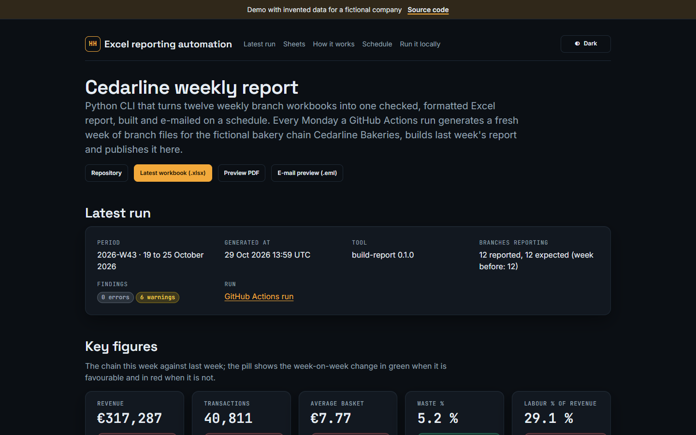
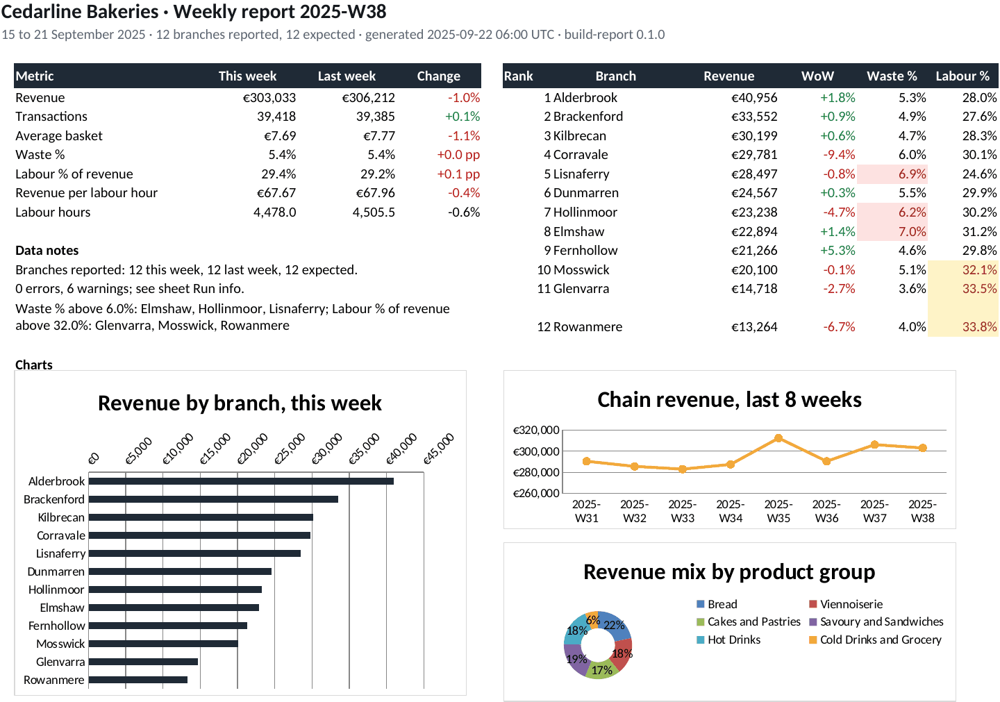
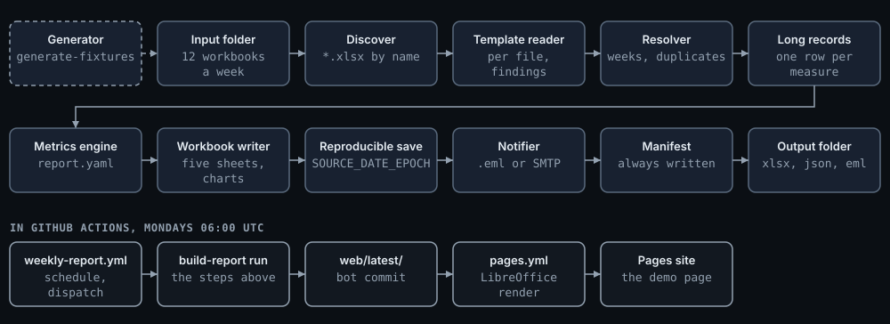

# excel-reporting-automation

[](https://github.com/HARISPAARTAN/excel-reporting-automation/actions/workflows/ci.yml)
[](https://github.com/HARISPAARTAN/excel-reporting-automation/actions/workflows/weekly-report.yml)
[](https://github.com/HARISPAARTAN/excel-reporting-automation/actions/workflows/pages.yml)
[](https://github.com/HARISPAARTAN/excel-reporting-automation/releases)

Python-CLI, die zwölf wöchentliche Filial-Arbeitsmappen zu einem geprüften, formatierten Excel-Bericht zusammenführt, nach Zeitplan erstellt und per E-Mail verschickt. [English](README.md)

## Status

Arbeit an v0.1.0. Geprüft auf dem Entwicklungsrechner (Windows 11, Python 3.13, uv): die Testsuite läuft durch (`uv run pytest`); der Demo-Lauf unter [Erste Schritte](#erste-schritte) endet mit Code 0 und den sechs Warnungen des Demo-Satzes, mit `--strict` mit Code 3 ohne Arbeitsmappe; zwei Läufe mit `SOURCE_DATE_EPOCH=1758520800` ergeben identische Bytes. Noch nicht geprüft: die CI-Jobs, das Rendering mit LibreOffice, der wöchentliche Lauf und die Pages-Seite.

## Auftrag

Cedarline Bakeries, eine erfundene Kette mit zwölf Bäckereien rund um Dublin, schrieb (übersetzt):

> Jeden Montag schickt jede Filialleitung der Zentrale eine Excel-Datei für die vergangene Woche: Umsatz nach Warengruppe, Abschriften, Arbeitsstunden und die Zahl der Transaktionen. Die Vorlage ist fest, in der Praxis werden aber Blätter umbenannt, Spalten ergänzt, und Dateien kommen doppelt oder mit der falschen Woche. Wir brauchen ein Python-Skript, das die Dateien aus einem Ordner sammelt, prüft, daraus einen formatierten Wochenbericht mit Kennzahlen, Veränderung zur Vorwoche, Filialranking und Diagrammen erstellt und ihn jeden Montagmorgen an die Zentrale schickt, ohne dass jemand Excel öffnet.

Aus dem Gedächtnis als Demo nachgebaut. Name und Daten des ursprünglichen Kundenunternehmens werden nicht verwendet.

Der vollständige Auftrag mit Rollen und Abnahmekriterien steht (auf Englisch) in [docs/brief.md](docs/brief.md).

## Live-Demo

[harispaartan.github.io/excel-reporting-automation](https://harispaartan.github.io/excel-reporting-automation/) zeigt den jeweils neuesten Wochenbericht: die Kennzahlen mit der Veränderung zur Vorwoche, das Filialranking, die Befunde des Laufs, Vorschauen der fünf Blätter aus LibreOffice sowie Links zur Arbeitsmappe, zur E-Mail und zu einem PDF der Blätter. Die Daten sind erfunden und werden jede Woche neu erzeugt.





Die übrigen Blätter des Demo-Berichts, auf dieselbe Weise gerendert: [Branches](docs/screenshots/branches.png), [Products](docs/screenshots/products.png), [Data](docs/screenshots/data.png) (die ersten 40 Zeilen) und [Run info](docs/screenshots/run-info.png).

## Funktionen

- **Vorlagenprüfung mit Befunden.** Jede Arbeitsmappe wird gegen die Vorlage Version 3 geprüft. Umbenannte Blätter, zusätzliche Spalten, eine fehlende oder widersprüchliche Woche, doppelte Einsendungen und fehlende Filialen werden nach festen Regeln aufgelöst und als Befunde mit Code gemeldet; Dateien mit Fehlern werden ausgeschlossen, die übrigen verwendet. `--strict` stoppt bei jedem Befund.
- **Kennzahlen aus der Konfiguration.** Zehn Kennzahlen sind Ausdrücke in [report.yaml](report.yaml), etwa `revenue / transactions`, ausgewertet für jede Filiale, jede Warengruppe und die Kette, mit Veränderung zur Vorwoche, Filialranking und Schwellenwerten.
- **Eine formatierte Arbeitsmappe.** Fünf Blätter (Summary, Branches, Products, Data, Run info) mit Werten in jeder Zelle und erzeugten Formeln in den Summenzeilen, eine Excel-Tabelle mit den Einzeldatensätzen, Zahlenformate, A4-Druckeinrichtung und Fußzeilen.
- **Diagramme und bedingte Formatierung.** Drei native Excel-Diagramme (Umsatz je Filiale, Umsatz der Kette über acht Wochen, Umsatzmix) und Regeln, die Schwellenwerte, Veränderungen und Schweregrade in der Arbeitsmappe selbst einfärben.
- **Benachrichtigung.** Die E-Mail mit den Kennzahlen und der Arbeitsmappe als Anhang wird als `.eml`-Datei geschrieben (`--notify dry-run`) oder zusätzlich per SMTP verschickt (`--notify smtp`); die SMTP-Einstellungen kommen nur aus Umgebungsvariablen.
- **Zeitplan.** Ein GitHub-Actions-Workflow erstellt den Demo-Bericht jeden Montag und veröffentlicht ihn auf der Pages-Seite; [docs/scheduling.md](docs/scheduling.md) enthält eine Aufgabendefinition für die Windows-Aufgabenplanung und eine cron-Zeile für den Betrieb auf einem Firmenrechner.
- **Nachvollziehbare Läufe.** Jeder Lauf schreibt ein Manifest mit dem SHA-256 jeder Eingabe und Ausgabe, den Befunden und den Zahlen; mit `SOURCE_DATE_EPOCH` ergeben zwei Läufe identische Bytes.

## So funktioniert es



Discover listet die Arbeitsmappen im Eingangsordner; der Vorlagenleser liest jede einzeln und hält Befunde fest; der Resolver ordnet die Wochen zu (das Deckblatt hat Vorrang vor dem Dateinamen), klärt Duplikate und markiert fehlende Filialen; aus den Meldungen werden Einzeldatensätze, einer je Filiale, Woche, Kategorie und Messgröße; die Kennzahlen-Engine wertet `report.yaml` aus; der Arbeitsmappen-Writer baut die Blätter, und das reproduzierbare Speichern packt die Datei neu; danach folgen die E-Mail und zuletzt das Manifest. Einzelheiten (auf Englisch): [docs/architecture.md](docs/architecture.md).

## Datenmodell

Jede Filiale schickt je ISO-Woche eine Arbeitsmappe `CL-NN_YYYY-Www.xlsx` mit den Blättern Cover (Filiale, Woche, Transaktionen, Einsendezeitpunkt), Sales (sechs Warengruppen: Nettoumsatz, Stückzahl, Abschriften in Stück und in EUR) und Labour (drei Rollen: Stunden, Kosten). Die zusammengeführten Daten bilden eine lange Tabelle, `tblWeekly`, mit einer Zeile je Filiale, Woche, Kategorie und Messgröße, sodass Filialwerte und Warengruppenwerte nie in derselben Zeile stehen. Die Kennzahlen, ihre Formate und die Richtung einer guten Veränderung sind in `report.yaml` festgelegt. Tabellen, Regeln und die sechs Abweichungen des Demo-Satzes: [docs/data-model.md](docs/data-model.md).

## Erste Schritte

Benötigt werden Python 3.11 oder neuer und [uv](https://docs.astral.sh/uv/).

```bash
git clone https://github.com/HARISPAARTAN/excel-reporting-automation.git
cd excel-reporting-automation
uv sync
uv run build-report validate --input data/incoming --period 2025-W38
uv run build-report run --period 2025-W38 --input data/incoming --out reports --notify dry-run
uv run pytest
```

Der Lauf schreibt `Cedarline_Weekly_Report_2025-W38.xlsx`, `.eml` und `.manifest.json` nach `reports/`. Alle Befehle und Optionen, die Exit-Codes, die Befunde und die Umgebungsvariablen: [docs/usage.md](docs/usage.md). Den Lauf jeden Montag einplanen: [docs/scheduling.md](docs/scheduling.md). Den Betrieb übernehmen: [docs/handover.md](docs/handover.md).

## Projektstruktur

```text
report.yaml                 die Konfiguration: Vorlage, Filialen, Kennzahlen, Schwellenwerte, Empfangsadressen
src/buildreport/            das Paket: Leseteil, Resolver, Kennzahlen-Engine, Arbeitsmappen-Writer, Manifest, Versand, CLI
data/incoming/              96 erfundene Filial-Arbeitsmappen, 2025-W31 bis 2025-W38, mit den Demo-Abweichungen
tests/                      pytest-Suite mit einer unabhängigen pandas-Referenz in tests/reference.py
tools/                      Demo-Daten, Rendering mit LibreOffice, Veröffentlichung auf Pages, Kit-Abgleich, Prüfungen
web/                        die Pages-Seite: index.html, assets/, das eingebundene portfolio-kit, latest/
docs/                       Auftrag, Datenmodell, Bedienung, Architektur, Zeitplan, Übergabe, ADRs
.github/workflows/          ci.yml, weekly-report.yml, pages.yml
```

## Entscheidungen

- [ADR 0001: Werte in den Zellen, Formeln nur in Summen](docs/adr/0001-values-with-formula-totals.md)
- [ADR 0002: Reproduzierbare Arbeitsmappen und E-Mails](docs/adr/0002-reproducible-workbooks.md)
- [ADR 0003: Die Woche auf dem Deckblatt hat Vorrang vor dem Dateinamen](docs/adr/0003-cover-week-wins.md)
- [ADR 0004: Wöchentlicher Commit des Berichts, Vorschau beim Deployment](docs/adr/0004-weekly-commit-and-pages-render.md)

Die ADRs sind auf Englisch.

## Im Vergleich zur ursprünglichen Lieferung

Der Nachbau ergänzt, was eine Übergabe an ein anderes Team braucht:

- einen schriftlichen Auftrag mit Rollen und Abnahmekriterien;
- Befunde mit Codes statt stiller Fehler und ein Manifest für jeden Lauf;
- Tests jeder Kennzahl gegen eine unabhängige pandas-Berechnung und eine Neuberechnung jeder Formelsumme mit LibreOffice in der CI;
- reproduzierbare Ausgaben: gleiche Eingaben und gleicher Zeitstempel ergeben identische Bytes;
- einen geplanten CI-Lauf, der den Bericht jede Woche erstellt und veröffentlicht;
- Dokumentation zu Bedienung, Zeitplan und Übergabe sowie vier Entscheidungsprotokolle.

## Lizenz und Datenhinweis

MIT, siehe [LICENSE](LICENSE). Die Seite nutzt portfolio-kit v0.1.0 (MIT) mit den Schriften Inter, Space Grotesk und JetBrains Mono unter der SIL Open Font License 1.1 ([web/kit/fonts/LICENSES.md](web/kit/fonts/LICENSES.md)). Änderungen: [CHANGELOG.md](CHANGELOG.md).

Cedarline Bakeries, die Filialen, Personen, Zahlen und E-Mail-Adressen sind erfunden; jede Adresse nutzt die reservierte Domain `cedarline.example`. Aus dem Gedächtnis als Demo nachgebaut. Name und Daten des ursprünglichen Kundenunternehmens werden nicht verwendet.

Englischer Originalwortlaut des Hinweises: "Rebuilt from memory as a demo. The original client's name and data are not used."
